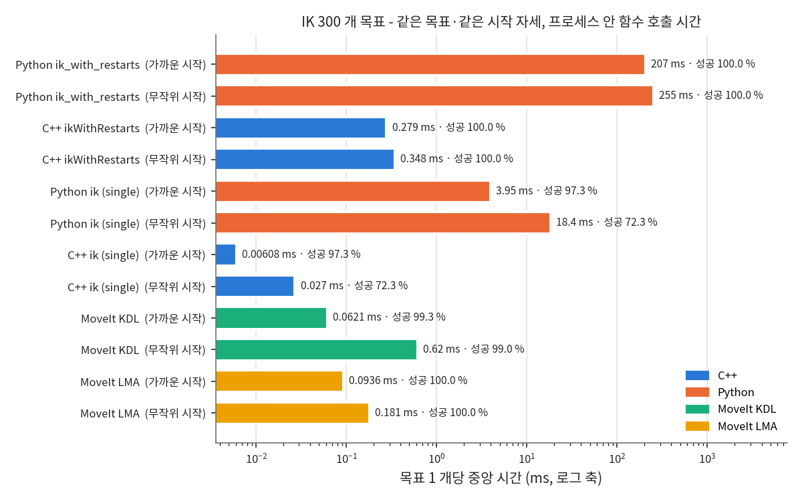
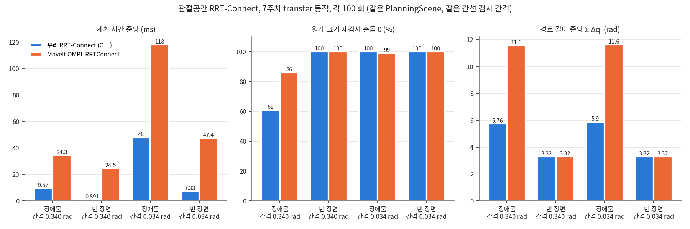
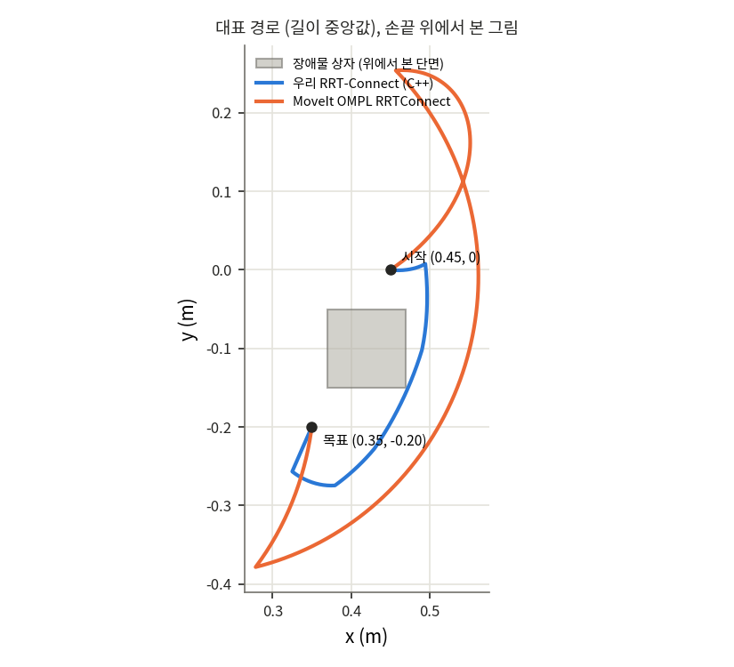
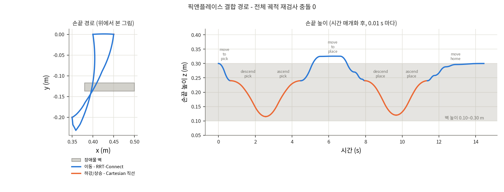

# 6축 모션 계획 파이프라인 C++ 직접 구현 (OMY-F3M)

> Sub project — 6주차 numpy IK 를 C++(Eigen)로 옮기고, 관절공간 RRT-Connect 와 Cartesian 경로를 직접 구현해
> 픽앤플레이스 파이프라인으로 결합. 같은 조건에서 Python / MoveIt 과 수치로 비교.

| 단계 | 내용 | 핵심 결과 |
|---|---|---|
| 1 | IK 이식 (FK · 기하 야코비안 · DLS → Eigen) | 같은 목표 300 개에서 **목표별 성공/실패가 Python 과 600/600 일치**, 중앙 시간 **254.9 ms → 0.35 ms (약 730 배)** |
| 2 | 관절공간 RRT-Connect + PlanningScene 충돌 판정 | 7주차 장애물 장면 100 회: 성공 100 %, 계획 시간 **48.0 ms vs MoveIt 118.1 ms**, 경로 길이 **5.9 vs 11.6 rad**, 재검사 충돌 0 **100 % vs 99 %** |
| 3 | 픽앤플레이스 (이동 RRT-Connect + 하강/상승 Cartesian) | 20 회 성공 100 %, **전체 궤적 재검사 충돌 점 수 0 (20/20)**, 전체 계획 중앙 65.1 ms, RViz mock 실행 확인 |

---

## 1. 동기

7주차 벤치마크 (`~/robot_ws/ik_benchmark/summary.csv`) 에서 우리 `ik_with_restarts` (Python/numpy) 는 성공률 100 % 였지만
목표 하나에 **중앙 262.8 ms** — MoveIt KDL (1.46 ms), LMA (0.75 ms) 보다 두 자릿수 이상 느렸다.
또 7주차 장애물 장면에서 관절 직선 보간 (방식 A) 은 상자를 통과 (충돌 188/301 점) 했고 MoveIt RRTConnect 만 풀 수 있었다.

목표: IK → 충돌 회피 계획 → 픽앤플레이스까지를 **라이브러리 호출 없이 직접** C++ 로 구현하고,
MoveIt 과 **같은 PlanningScene · 같은 목표 · 같은 간선 검사 간격**에서 비교한다.

## 2. 구조

```
                    ┌─────────────────────── omy_motion_core (라이브러리) ───────────────────────┐
 URDF ─────────────▶│ Kinematics        FK / 야코비안 (FK 1 회로 둘 다) / DLS ik / ikWithRestarts   │
 URDF + SRDF ──────▶│ CollisionChecker  MoveIt PlanningScene (FCL + 허용 충돌 행렬) 감싸기          │
                    │                   isValid · isMotionValid (이분 순서) · attach / detach        │
                    │ RrtConnect        두 트리 extend/connect · L1 거리 · OMPL 식 shortcut         │
                    │ cartesianPath     5 mm 직선 + slerp · 직전 해 시드 IK · 점프/충돌 검사 → fraction │
                    │ timeParameterize  사다리꼴 속도 (joint_limits.yaml), RRT 는 꼭짓점 정지          │
                    └────────────────────────────────────────────────────────────────────────────┘
 apps/  ik_benchmark (1단계)   rrt_benchmark (2단계)   pick_place_pipeline (3단계, execute:=true 로 실행)
```

| 파일 | 구성 | 역할 |
|---|---|---|
| `src/kinematics.cpp` | FK·야코비안·DLS | `omy_ik_demo.py` 의 `Kinematics`, `ik_with_restarts` 1:1 이식 |
| `src/collision_checker.cpp` | 충돌 판정 | MoveIt 과 같은 `PlanningScene` 객체 사용 → 판정 기준 동일 |
| `src/rrt_connect.cpp` | RRT-Connect | 범위·거리·간선 검사를 OMPL 규칙에 맞춤 |
| `src/cartesian_path.cpp` | Cartesian 직선 | MoveIt `computeCartesianPath` 와 같은 의미 (fraction) |
| `src/trajectory.cpp` | 시간 매개화 | 관절별 속도·가속도 한계 사다리꼴 |

## 3. 1단계 — IK (Python vs C++ vs MoveIt)

**조건**
- 목표 300 개 = 7주차 `experiment_a_targets(kin, 300, seed=1)` 그대로. numpy PCG64 를 C++ 에서 재현하지 않고
  `scripts/export_ik_reference.py` 가 목표·시작 자세·`ik_with_restarts` 의 무작위 시드 30 개를 CSV 로 넘김 → **완전히 같은 입력**.
- 모두 **같은 프로세스 안 함수 호출 시간** (ROS 서비스 왕복 없음). MoveIt 은 kinematics 플러그인 `searchPositionIK` 직접 호출 (timeout 0.05 s).
- 성공 = 결과 관절각을 우리 FK 로 다시 계산해 위치 1 mm, 자세 0.01 rad 이내 (7주차와 같음).

| 방식 | 시작 | 성공 % | 중앙 ms | 90 % ms | 최대 ms |
|---|---|---:|---:|---:|---:|
| Python `ik_with_restarts` | 무작위 | 100.0 | 254.87 | 1552.0 | 6406.7 |
| **C++ `ikWithRestarts`** | 무작위 | **100.0** | **0.348** | 2.07 | 8.70 |
| Python `ik_with_restarts` | 가까운 | 100.0 | 207.17 | 405.4 | 6451.3 |
| **C++ `ikWithRestarts`** | 가까운 | **100.0** | **0.279** | 0.53 | 8.73 |
| Python `kin.ik` 1 회 | 무작위 / 가까운 | 72.3 / 97.3 | 18.43 / 3.95 | | |
| C++ `ik` 1 회 | 무작위 / 가까운 | 72.3 / 97.3 | 0.027 / 0.0061 | | |
| MoveIt KDL | 무작위 / 가까운 | 99.0 / 99.3 | 0.620 / 0.062 | 7.11 / 0.40 | 54.1 / 54.1 |
| MoveIt LMA | 무작위 / 가까운 | 100 / 100 | 0.181 / 0.094 | 0.71 / 0.12 | 4.39 / 1.10 |



- **정확성**: C++ FK 와 Python FK 차이 최대 4.4e-16, 목표별 성공/실패 600/600 일치 (같은 알고리즘이 그대로 옮겨졌다는 증거).
- **속도**: 같은 알고리즘에서 약 **680~740 배**. 원인 — numpy 작은 행렬 (4x4, 6x6) 연산의 호출 오버헤드, 고정 크기 Eigen 행렬 (힙 할당 없음),
  반복마다 FK 를 두 번 (오차, 야코비안) 부르던 것을 한 번으로.
- **MoveIt 대비**: 무작위 시작에서 KDL 보다 빠르고 LMA 와 같은 자릿수. 가까운 시작에서는 KDL/LMA 가 더 빠름
  (우리 재시작 전략은 joint6 회전 시드를 먼저 시도하는 등 7주차 데모용 규칙 그대로라서). 허용 오차는 우리 0.1 mm, KDL 0.01 mm 로 다름.

## 4. 2단계 — 관절공간 RRT-Connect (C++ vs MoveIt OMPL)

**조건 (공정 비교)**
- 장면: 7주차 장애물 상자 0.10 × 0.10 × 0.30 m, 중심 (0.42, −0.10, 0.20). 계획은 padding 5 mm, 검증은 원래 크기 (7주차와 같은 규칙).
- 동작: 7주차 transfer (0.45, 0, 0.24) yaw 0 → (0.35, −0.20, 0.24) yaw 90°.
- **두 플래너가 같은 `PlanningScene` 객체**로 충돌 판정. MoveIt 은 request adapter (시간 매개화 등) 없이 planner 만, `num_planning_attempts = 1`.
- 거리 = 관절별 |차이| 합 (MoveIt `JointModelGroup::distance`), range = 0.2 × 상태공간 크기 (OMPL 기본).
- 간선 검사 간격 = `longest_valid_segment_fraction` × 68.07 rad. **두 값** 으로 비교: 0.005 (omy_moveit_config 설정 = 0.34 rad), 0.0005 (0.034 rad).
- 검증: 경로를 관절 0.005 rad 간격으로 촘촘히 나눠 원래 크기 상자 scene 에서 다시 검사한 충돌 점 수. 각 100 회.

| 장면 | 간선 간격 | 플래너 | 성공 % | 중앙 ms | 90 % ms | 경로 길이 중앙 (rad) | 재검사 충돌 0 % |
|---|---|---|---:|---:|---:|---:|---:|
| 장애물 | 0.34 rad | **우리** | 100 | **9.6** | 16.1 | **5.76** | 61 |
| 장애물 | 0.34 rad | MoveIt | 100 | 34.3 | 46.2 | 11.59 | 86 |
| 장애물 | 0.034 rad | **우리** | 100 | **48.0** | 74.6 | **5.90** | **100** |
| 장애물 | 0.034 rad | MoveIt | 100 | 118.1 | 157.4 | 11.63 | 99 |
| 빈 장면 | 0.34 rad | 우리 / MoveIt | 100 / 100 | 0.89 / 24.5 | | 3.32 / 3.32 | 100 / 100 |
| 빈 장면 | 0.034 rad | 우리 / MoveIt | 100 / 100 | 7.3 / 47.4 | | 3.32 / 3.32 | 100 / 100 |




- **간선 검사 간격이 결과를 좌우한다.** 기본 0.34 rad 에서는 두 플래너 모두 원래 크기 상자와 닿는 경로가 나옴
  (우리 39 %, MoveIt 14 % — 손가락 `rh_p12_rn_l2/r2` 가 대부분, MoveIt 은 `link3-link6` 자기 충돌도 2 회).
  7주차에 MoveIt 경로가 상자를 0.6~3.5 mm 파고들어 padding 을 넣었던 것과 같은 현상. 10 배 촘촘하게 하면 우리 100 %, MoveIt 99 %.
  우리 쪽 비율이 기본 간격에서 더 나쁜 이유: shortcut 이 경로를 절반 길이로 줄이면서 장애물에 바짝 붙는 긴 간선이 생기기 때문.
- **속도**: 같은 간격에서 2.5~3.6 배 (장애물), 6~27 배 (빈 장면). MoveIt 시간에는 매 요청 planning context 생성, OMPL 설정,
  B-spline 단순화, 경로 보간이 포함되어 있음 — 순수 탐색 비교가 아님을 밝혀 둔다.
- **경로 길이**: 경로 위 임의의 두 점을 잇는 shortcut (OMPL `shortcutPath` 방식) + 꼭짓점 줄이기로 MoveIt 의 절반.
  처음 구현 (꼭짓점끼리만 shortcut) 은 37.7 rad 로 MoveIt 의 3 배였음 → 개선 과정도 기록.
- 최근접 탐색은 선형 탐색. 노드 수가 수백 개라 kd-tree 없이도 충분 (병목은 충돌 판정).
- 남은 MoveIt 1 건 (0.034 rad) 은 `link4-link6` 자기 충돌 2 점. 원인은 따로 확인하지 않음.

## 5. 3단계 — 픽앤플레이스 결합

```
READY ─RRT→ 큐브 위 ─직선↓→ 잡기(attach) ─직선↑→ ─RRT→ 놓을 곳 위 (yaw 90°) ─직선↓→ 놓기(detach) ─직선↑→ ─RRT→ READY
```
- 위치는 `omy_ik_demo.py` 그대로: 큐브 (0.45, 0, 0.12), 놓는 곳 (0.35, −0.20), 위 높이 0.24 m, 집는 높이 0.115 m.
- 장면: 테이블 (table.world) + 큐브 + 장애물. 잡은 뒤 큐브는 **attached object** 로 충돌 판정에 포함.
  집으러 내려갈 때 열린 손가락과 큐브의 접촉은 허용 충돌 행렬로 허용 (MoveIt Task Constructor 와 같은 처리).
- **장애물 위치**: 7주차 상자는 큐브 위에서 손목 (`link6`) 과 겹쳐 하강 자체가 불가능 (7주차 기록과 같은 결과를 C++ 로 확인, fraction 0.19).
  집는/놓는 자세에서 손목·카메라·손가락의 충돌 상자를 계산해 두 자세 사이 빈 공간 (y −0.149 ~ −0.104) 에
  **얇은 벽 0.12 × 0.02 × 0.20 m, 중심 (0.44, −0.127, 0.20)** 을 세움 (두 자세와 padding 포함 7 mm 이상).
  관절 직선 이동은 이 벽을 **130/207 점** 통과 → RRT-Connect 가 벽 위로 넘어가는 경로를 찾아야 함.
- 간선 검사 간격은 2단계 결과에 따라 0.034 rad.
- 검증: 시간 매개화까지 끝난 **전체 궤적을 0.01 s 마다**, 원래 크기 scene 에서 잡기/놓기 상태를 그대로 재현하며 다시 검사.

| 구간 | 방법 | 성공 | 계획 중앙 ms | 동작 s | 직선 이탈 최대 mm | 충돌 점 (20 회 합) | 관절 직선이면 |
|---|---|---:|---:|---:|---:|---:|---:|
| move_to_pick | RRT-Connect | 20/20 | 8.6 | 0.66 | | 0 | 0/30 |
| descend_pick | Cartesian | 20/20 | 0.58 | 1.91 | 0.075 | 0 | |
| ascend_pick | Cartesian | 20/20 | 0.64 | 1.91 | 0.078 | 0 | |
| move_to_place | RRT-Connect | 20/20 | 28.8 | 4.14 | | 0 | **130/207** |
| descend_place | Cartesian | 20/20 | 0.58 | 1.70 | 0.066 | 0 | |
| ascend_place | Cartesian | 20/20 | 0.52 | 1.70 | 0.070 | 0 | |
| move_home | RRT-Connect | 20/20 | 20.7 | 2.95 | | 0 | 37/211 |
| **전체** | | **20/20** | **65.1** (90 % 94.3) | 약 15 | | **0** | |



- 오른쪽 그림: `move_to_place` 에서 손끝이 0.325 m 까지 올라가 벽 (윗면 0.30 m) 을 넘음. 하강/상승은 직선 이탈 0.08 mm 이하.
- RRT 경로는 꼭짓점마다 멈추는 시간 매개화 → 실제 궤적이 충돌 검사한 관절 직선과 **정확히 같음**
  (TOTG 는 꼭짓점을 둥글게 깎아 검사하지 않은 곳을 지남 — 7주차 padding 의 원인). 대신 동작 시간이 김 (개선 과제).
- `execute:=true`: `demo_mock.launch.py` 의 `/arm_controller`, `/gripper_controller` 로 10 구간 실행 완료, 끝 자세 READY 확인.

## 6. 결론

1. 같은 DLS 알고리즘을 Eigen 으로 옮기는 것만으로 IK 가 약 730 배 빨라졌고 (목표별 결과 완전 일치), MoveIt KDL/LMA 와 같은 자릿수가 됨.
2. MoveIt 과 같은 PlanningScene · 같은 간선 간격에서 직접 만든 RRT-Connect 가 2.5 배 빠르고 경로가 절반 길이.
3. **간선 검사 간격 (`longest_valid_segment_fraction`) 이 충돌 안전성의 핵심 변수**임을 수치로 확인 — 기본값에서는 두 플래너 모두
   원래 크기 장애물과 닿는 경로를 낸다. 파이프라인은 10 배 촘촘한 간격 + 꼭짓점 정지 시간 매개화로 전체 궤적 충돌 0 을 보장.
4. IK · 충돌 판정 · 샘플링 계획 · Cartesian 경로 · 시간 매개화를 결합해 픽앤플레이스 20 회 100 % 성공, 충돌 점 0.

**한계 / 다음 과제**: 꼭짓점 정지 대신 충돌 검사를 포함한 부드러운 시간 매개화, 가까운 시작에서 KDL 보다 느린 재시작 규칙 개선,
kd-tree 최근접 (노드가 많아지는 좁은 통로 장면), 실제 OMY 하드웨어 실행.

## 7. 실행 방법

```bash
cd ~/robot_ws
colcon build --packages-select omy_motion_cpp --symlink-install --cmake-args -DCMAKE_BUILD_TYPE=Release
source install/setup.bash

ros2 run omy_motion_cpp export_ik_reference.py          # 목표 300 개 + Python 시간 (약 4 분, --skip-python 이면 목표만)
colcon test --packages-select omy_motion_cpp            # FK = Python (1e-9), 야코비안 = 수치 미분, IK, wrap
ros2 launch omy_motion_cpp benchmark.launch.py app:=ik_benchmark
ros2 launch omy_motion_cpp benchmark.launch.py app:=rrt_benchmark params:='trials:=100'
ros2 launch omy_motion_cpp benchmark.launch.py app:=pick_place_pipeline params:='runs:=20'
ros2 run omy_motion_cpp plot_results.py

# RViz mock 에서 실행
ros2 launch omy_moveit_config demo_mock.launch.py
ros2 launch omy_motion_cpp benchmark.launch.py app:=pick_place_pipeline params:='execute:=true'   # /pick_place_path 마커
```
결과: `~/robot_ws/motion_cpp_results/{ik,rrt,pick_place}/` (CSV) 와 그래프 PNG.
측정 환경: Ubuntu 22.04, ROS 2 Humble, MoveIt 2.5.9, Eigen 3.4, 12 스레드 CPU, Release 빌드.
